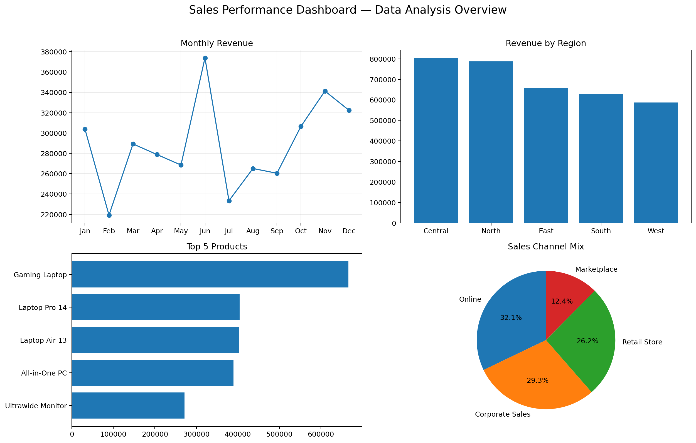
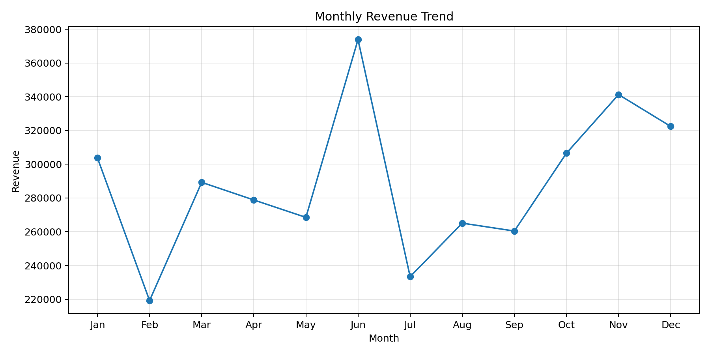
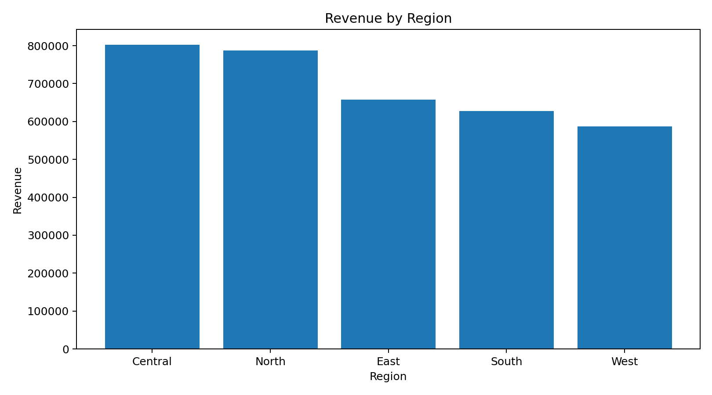
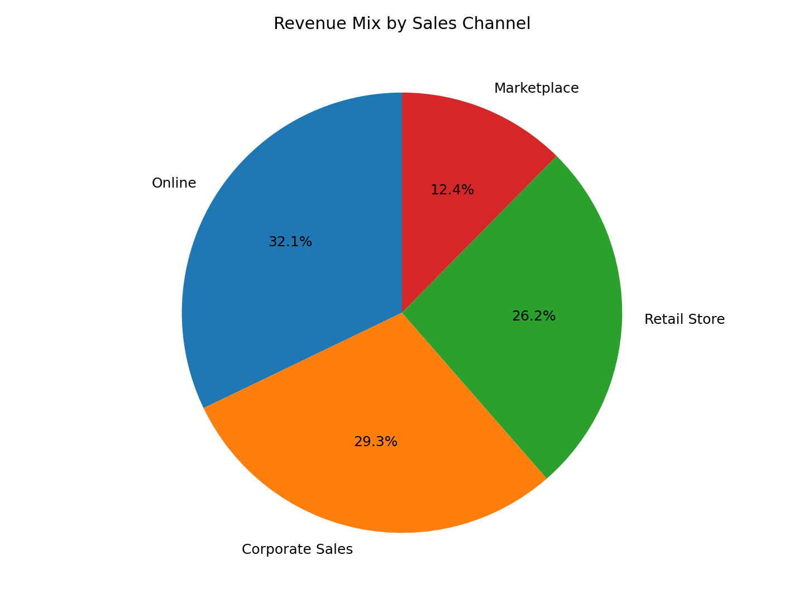
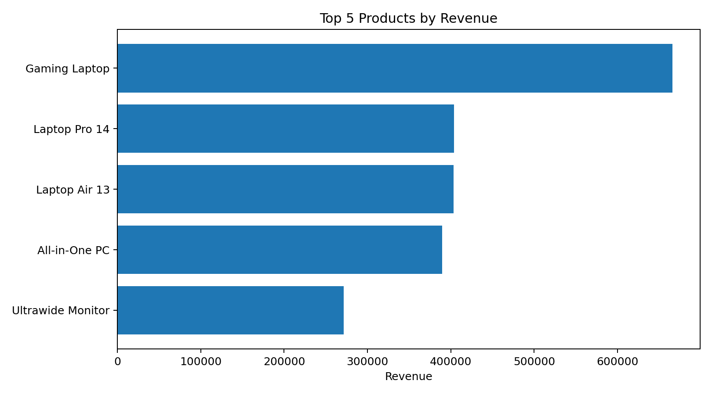
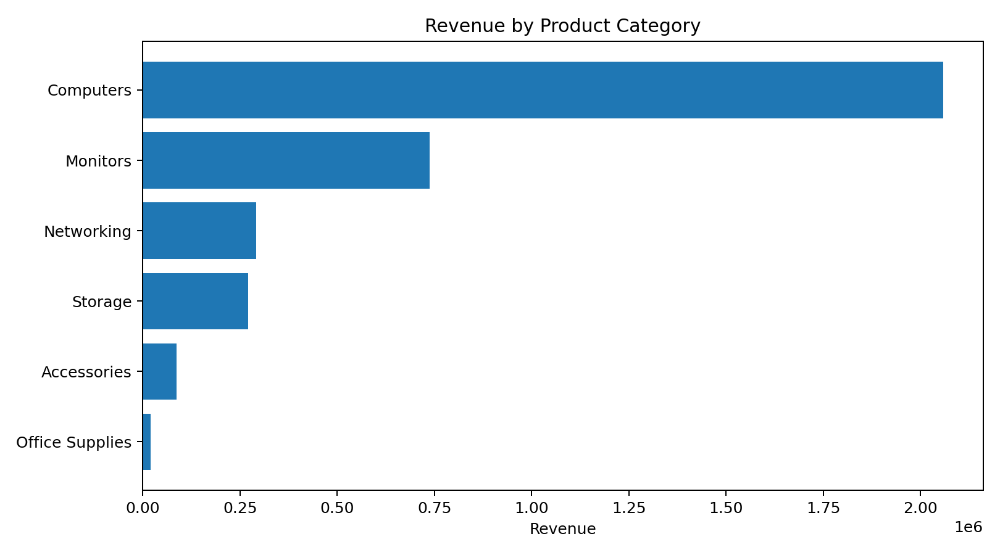

# Sales Performance and Business Analytics | Excel Dashboard

**An end-to-end Excel analytics project transforming 2,000 sales records into business performance insights through data cleaning, PivotTables, revenue analysis and dashboard visualisation.**

## Dashboard Preview

## Business Context

Understanding sales performance requires more than looking at total revenue. Businesses need to know which regions generate the most revenue, which products contribute the most, how customers purchase and how performance changes over time.

This project uses Excel to organise sales records, analyse key performance indicators and present findings through an interactive-style dashboard.

## Performance Snapshot

| KPI | Result |
|---|---:|
| Total Sales Records | 2,000 |
| Total Revenue | 3,462,605.32 |
| Average Revenue per Record | 1,731.30 |
| Total Quantity Sold | 7,552 |
| Regions Covered | 5 |
| Sales Channels | 4 |

## Questions Explored

- How does revenue change across the months?
- Which regions contribute the most to overall revenue?
- Which sales channels generate the highest revenue?
- Which product categories drive sales?
- Which individual products are the strongest revenue contributors?

## Key Findings

**1. Regional Performance**

Central generated the highest revenue at 802,603.64, followed by North at 787,107.33.

**2. Sales Channel Performance**

Online sales contributed the highest revenue at 1,112,657.22, followed by Corporate Sales at 1,013,948.69.

**3. Product Performance**

Computers was the leading product category, generating 2,058,536.24 in revenue.

Gaming Laptop was the highest-revenue individual product at 665,930.53.

**4. Monthly Revenue Trend**

June recorded the highest monthly revenue at 373,916.30, while February recorded the lowest at 219,186.72.

## Visual Analysis

### Monthly Revenue Trend

### Revenue by Region

### Sales Channel Contribution

### Top 5 Products by Revenue

### Revenue by Product Category

## Analytical Workflow

| Stage | Work Performed |
|---|---|
| Data Preparation | Reviewed source records, checked data quality and prepared the dataset for analysis |
| Data Cleaning | Worked on data consistency and preparation in Excel |
| Data Analysis | Used Excel formulas and PivotTables to summarise sales performance |
| Business Analysis | Compared revenue across regions, channels, products and months |
| Visualisation | Created a dashboard with five charts to communicate key performance indicators and trends |

## Excel Skills Demonstrated

- Data cleaning and preparation
- Excel formulas and data organisation
- PivotTables and revenue summaries
- KPI analysis
- Sales and product performance analysis
- Dashboard creation and chart visualisation
- Business insight communication

## Repository Contents

| File | Description |
|---|---|
| `Sales Dashboard.xlsm` | Excel workbook containing the PivotTables, analysis and dashboard |
| `Data (2).xlsx` | Original sales dataset |
| `images/` | Dashboard preview and analytical visualisations |

## Conclusion

This project demonstrates how Excel can be used to turn raw sales records into structured business intelligence. By combining data preparation, PivotTable analysis and dashboard visualisation, the analysis highlights revenue patterns, regional performance, channel contribution and product-level opportunities.

The project strengthened my practical skills in Excel-based data analytics and communicating findings through business-focused visualisations.
